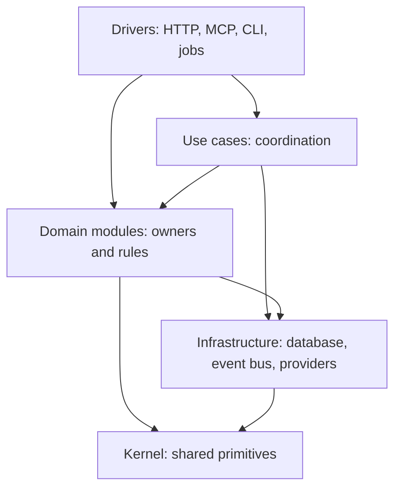
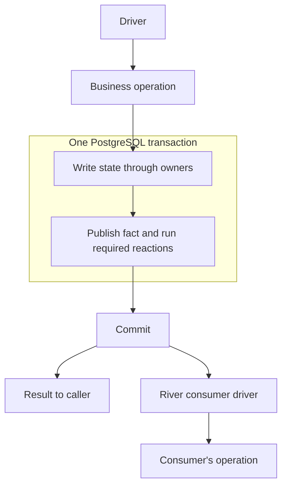
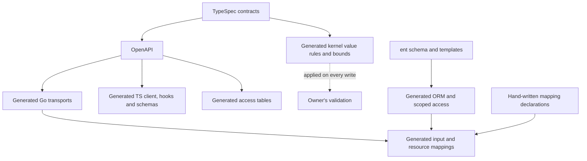
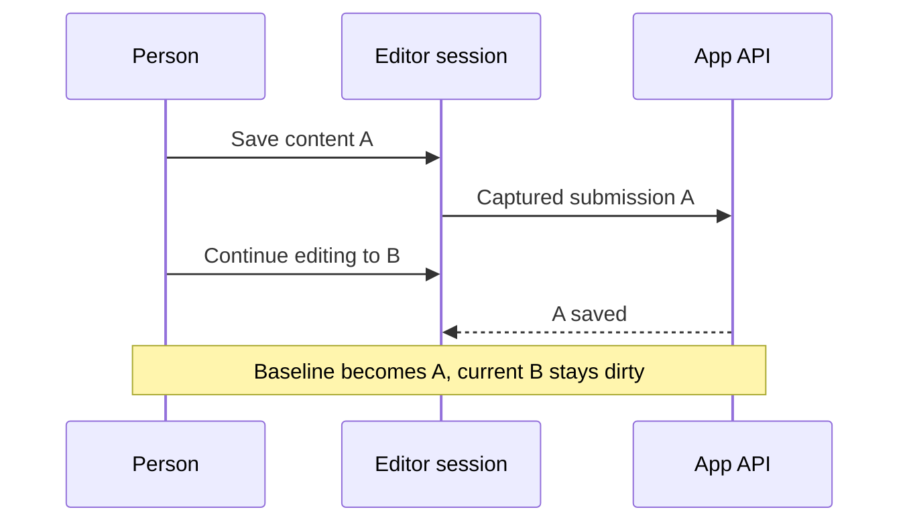

# Architecture overview

This is the direction Sphericon's code should move toward. The implementation is still converging
on it: an existing pattern may be an unfinished migration. Use these principles to place new work
and refactor the code it touches. The linked ADRs record the decisions and can revise them as we
learn; this overview does not settle every design detail.

Sphericon combines a Go backend, a React app and browser tracking. A Workspace is the boundary for
its Contacts, Events and marketing activity; an Instance runs the application and holds the
configuration shared by its Workspaces. The [glossary](../GLOSSARY.md) defines these terms.

## Layers and dependencies

Keep business decisions independent of how an operation is reached. Arrows below show important
code dependencies. The use case layer is open: a driver may call a domain operation directly.

Domain contexts are ordered from identity through contacts, content, sending, orchestration and
insights to instance. A module may depend on its own context and those below it. A lower context
knows nothing about the contexts that use it. The kernel imports no application packages;
infrastructure imports no domain modules.

Wiring assembles dependencies and owns their lifetime. A module receives its dependencies, the
Instance clock included, rather than looking them up. An interface to an outside service provides
a real production/test seam; interfaces between internal modules do not make a forbidden dependency
acceptable. Edition integration belongs in wiring; the core imports no `ee/` code.

See [ADR 0102](adr/0102-the-core-is-layered-and-an-operation-across-modules-is-a-use-case.md) and
[ADR 0112](adr/0112-an-operation-belongs-to-the-module-that-owns-its-subject.md).

## Operations, use cases and surfaces

A domain module owns its rows, their writes and their invariants. It checks its own inputs on every
path, including jobs and the CLI. Transport validation is useful early feedback; the owner remains
responsible for the rule. Expected refusals use a shared taxonomy and are mapped once to each
surface's response. A broken storage invariant is a fault, not a validation message for the caller.

Place an operation with the module that owns its subject. Use a **use case** when that owner would
need a dependency above its context, or when an operation combines contexts without a single owner
(including a License decision with core rows). An operation without its own table can still be a
domain module. Calling several modules alone does not make something a use case. For example,
Transactional send belongs to Outbound messages; deleting a Tag needs coordination with the higher
contexts that use it.

The app API, external API, collection and Staff surfaces have distinct contracts and authentication.
MCP projects the external API. HTTP handlers, CLI commands, workers and event consumers are all
drivers: each function receives input, calls one operation of a module or use case, and presents the
result. A shared operation gives the same business answer through every surface. Wiring handles no
input, and drivers compose no business workflow.

See [ADR 0107](adr/0107-a-domain-module-checks-every-input-to-its-writes.md),
[ADR 0111](adr/0111-every-entry-point-is-a-driver-that-calls-one-operation-of-the-core.md) and the
[use case call contract](adr/0104-a-use-case-has-one-call-contract.md).

## Data, transactions and events

Workspace data travels through a scoped client carrying the Workspace and actor. Privileged
Instance-wide access is explicit and limited. The operation owns its transaction; a use case
coordinates writes through the rows' owners. Constraints and foreign keys protect declarative
invariants in PostgreSQL; business decisions stay in Go.

The flow below is a write that publishes a fact. A read returns through the same operation and
surface mapping without publishing work.

Publication records its receipt, an Event row where applicable, the journal and consumer jobs in the
same transaction. A failed transaction leaves neither partial reactions nor queued jobs. The producer
publishes a fact without naming consumers. Mandatory reactions preserve consistency before commit; independent
work runs afterwards, with retries and idempotent handling. Jobs have no global ordering promise.

Domain rows remain the stored business state. Projecting a fact into the Event log and replaying
retained inputs for selected reports are separate mechanisms; replay does not republish the fact.
See the [event system](design/domain-events.md) for the detailed flow and guarantees.

## States and concurrency

Choose the representation from the history and legal moves it must preserve:

- A **machine** declares its states and permitted transitions in the owner.
- A **latch** records a one-way fact once, such as a credential being used or revoked.
- An **attribute** is a chosen value or an observation, without a lifecycle of its own.

Declare that distinction in the schema. A transition uses a conditional write against what it
observed, so an old job or response cannot overwrite a newer decision. A multi-row invariant needs
a transaction and the appropriate coordination. Live use checks and writes share the Workspace lock;
the target types carry evidence of that lock and of row locks on hot paths. CAS protects the state
being changed, while locks coordinate work that must share a consistent view.

Saving an Automation or Rule changes its draft; Publish makes it live. Work already started keeps
its version. Archiving stops new use; discarding retains a historical row; Erasure removes personal
data under its own rules. These are distinct operations, not interchangeable status flags.

See [ADR 0109](adr/0109-a-state-is-a-machine-or-a-latch-declared-in-the-schema.md),
[ADR 0108](adr/0108-a-write-that-moves-live-use-holds-the-lock-its-check-holds.md) and
[draft/live definitions](adr/0065-a-live-automation-or-rule-changes-only-by-publish.md).

## Contracts and generation

State knowledge once and derive the forms its consumers need. TypeSpec owns API operations, shapes,
constraints and access declarations. The ent schema owns persistence. They describe different
contracts; mappings connect them.

Solid arrows are build-time generation inputs; the dotted arrow shows the owner applying generated
rules. Change the authoritative input and regenerate;
hand-written extensions hold the decisions a generator cannot infer. The same principle applies to
fixtures, locale catalogs, routes and configuration documentation. A new API field crosses the
contract, the owner's validation, persistence where needed, mappings and client; copied types or
bounds hide omissions.
See the [generation reference](agents/codegen.md) for sources, outputs and commands.

## Frontend state

Routes bind pages; shared components do not depend on feature pages. Pages use the generated client
and query cache for server data. Editable content has a separate owner: refreshing a query must not
replace unsaved work. Shared resource forms carry common mechanics; feature adapters carry the
content-specific decisions.

An editor distinguishes current content, the captured submission and the acknowledged baseline.
Save acknowledges that submission while preserving edits made afterwards. Save, Publish and Revert
run through one operation session, so they cannot overlap accidentally.

This is the shared editor model being extracted in [#1243](https://github.com/getsphericon/sphericon/issues/1243)
and applied to resource forms in [#1244](https://github.com/getsphericon/sphericon/issues/1244).
The [UI standards](standards/ui.md) define the behavior people see.

## Testing the model

Test the exported operation where the decision belongs. Exercise real internal modules and a real
database; replace outside systems with controlled stubs. Assert the observable business result,
rather than which helper was called. Moving responsibility to an owner moves its tests there too.

Fixtures supply starting data. Most database tests roll back a transaction; tests needing real
commits use an isolated database. Control the clock, queued jobs and the order of concurrent actions
explicitly. Repeating a test until a race appears or sleeping to guess completion gives no reliable
evidence. Pure decisions get property tests, parsers get fuzz tests, and critical UI paths get
browser coverage while their decision logic is tested directly.

## Applying the model

When changing code, identify the owner, check the dependency direction, then follow the data through
its transaction, state changes, generated forms and tests. Move the touched code toward this model;
record an unresolved design question rather than inventing a new abstraction to make it fit.

The [review rules](standards/review-rules.md) state requirements;
[coding standards](../CODING_STANDARDS.md) explain their mechanics;
[ADRs](adr/) record the decisions and refinements. The [architecture reference](architecture.md)
holds detailed implementation guidance. Parts of the transition are tracked in
[#1200](https://github.com/getsphericon/sphericon/issues/1200) (checked operations and drivers) and
[#1194](https://github.com/getsphericon/sphericon/issues/1194),
[#1195](https://github.com/getsphericon/sphericon/issues/1195),
[#1196](https://github.com/getsphericon/sphericon/issues/1196) and
[#1197](https://github.com/getsphericon/sphericon/issues/1197) (validation, states, locks and hooks).
An accepted decision describes the target; it does not mean every caller or automated check already
follows it.
