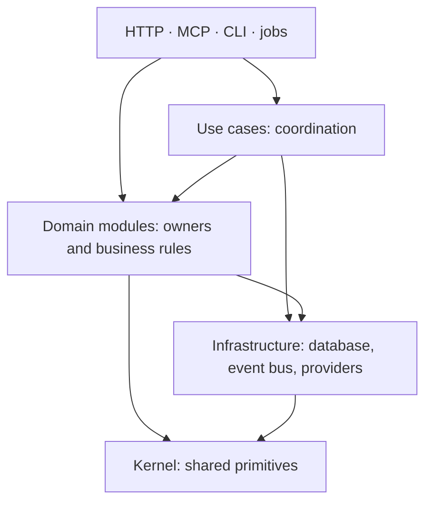

# Architecture

Sphericon is a Go backend, a React app and browser tracking, backed by PostgreSQL.
A **Workspace** owns its Contacts, Events and marketing activity; an **Instance** runs the app
and holds shared configuration. The [glossary](../GLOSSARY.md) defines the domain language.

This is the target model. Existing code is still converging on it; the [ADRs](adr/) record
accepted decisions, and an accepted decision does not mean every caller already follows it.

## Where code belongs

A driver calls one business operation and presents its result. The module that owns the subject
owns the operation, its writes and validation. A use case coordinates work that crosses the
allowed dependency direction or has no single owner. Calling several modules alone does not
make an operation a use case.

Domain contexts are ordered: **identity → contacts → content → sending → orchestration → insights
→ instance**. A module may depend on its own context and those earlier in the list. Infrastructure
imports no domain modules; the kernel imports no application packages. Wiring assembles dependencies
and their lifetime. The core imports no `ee/` code; wiring integrates the Edition.

## How work runs

A write follows **driver → operation → transaction → commit**. The operation uses the rows' owners
and a Workspace-scoped client. Publication records the fact and required reactions in that same
transaction, together with jobs for independent work. River runs those jobs after commit;
consumers handle retries and repeated delivery. A failed transaction leaves no queued work.
Retained report inputs can be replayed without republishing the original fact.

The schema declares each state field a machine, a one-way latch or an ordinary attribute
(`schema.Form`, ADR 0109), and the `statemoment` analyzer holds every write of a machine or a latch
to the `lifecycle` primitives. The owner declares legal transitions. Conditional writes reject stale
changes, an archived row's included; locks coordinate invariants across rows and Live use. Saving a draft, publishing it and archiving it are separate
operations, and work already started keeps its version.

## Contracts, frontend and tests

TypeSpec owns API contracts and generates OpenAPI, Go transports and the TypeScript client.
The ent schema owns persistence; generated mappings connect stored rows to API resources.
Change the source and regenerate. The [generation guide](agents/codegen.md) lists the pipeline.

The frontend uses the generated client and query cache for server data. Editors own unsaved work:
Save acknowledges the submitted snapshot while preserving later edits. Shared forms and editor
sessions carry this behavior; feature adapters carry content-specific decisions.

Test the exported operation where its decision belongs, using real internal modules and a real
database. Replace outside systems with controlled stubs; control time, jobs and concurrency explicitly.

## Read for your change

| When changing…                                                    | Read…                                                                                     |
| ----------------------------------------------------------------- | ----------------------------------------------------------------------------------------- |
| Wiring, API surfaces, authentication or response mapping          | [Backend](architecture/backend.md)                                                        |
| Package placement, context dependencies or table ownership        | [Modules](architecture/modules.md)                                                        |
| An operation spanning owners or contexts                          | [Use cases](architecture/use-cases.md)                                                    |
| Database access, scoped-client construction or a raw ent client   | [Workspace scoping](architecture/workspace-scoping.md)                                    |
| License gates, Edition wiring or audit capture                    | [Enterprise Edition](architecture/enterprise.md)                                          |
| Removal checks, stored Steps or Workspace locking                 | [Lifecycles](architecture/lifecycles.md)                                                  |
| Publication, Notices, consumers, replay or job cleanup            | [Events and jobs](architecture/events-and-jobs.md), [event flow](design/domain-events.md) |
| Outbound retries, HTTP Actions, email rendering or tracker builds | [Messaging](architecture/messaging.md)                                                    |
| Resource form hydration, request conversion or saved state        | [Frontend forms](architecture/frontend.md), [UI standards](standards/ui.md)               |

The [review rules](standards/review-rules.md) define what each change must satisfy;
[coding standards](../CODING_STANDARDS.md) cover implementation and testing conventions.
